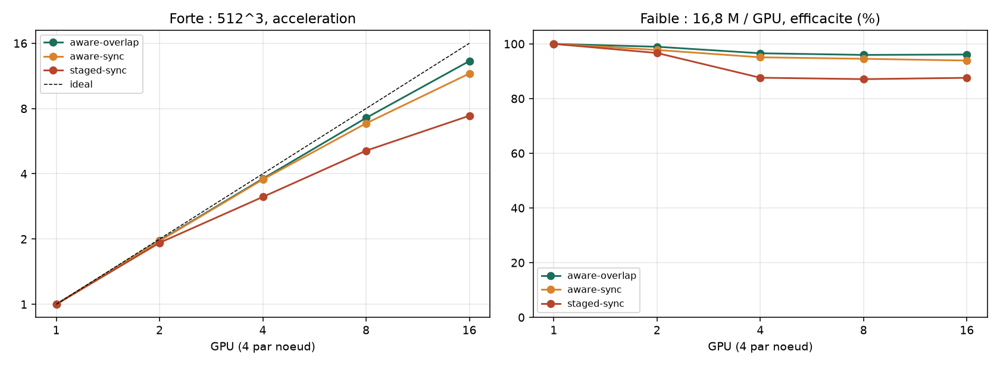

# Gradient conjugué multi-GPU (MPI + CUDA) sur GH200

Ce projet est un gradient conjugué préconditionné (Jacobi) pour un Poisson 3D, distribué sur plusieurs GPU avec MPI. Il compare trois façons d'échanger les halos entre GPU, et mesure la scalabilité forte et faible sur le supercalculateur ROMEO, jusqu'à 16 GPU NVIDIA GH200 répartis sur 4 nœuds.



## Résultats (médiane de 5 répétitions)

| | 1 GPU | 4 GPU (1 nœud) | 16 GPU (4 nœuds) |
|---|---|---|---|
| Forte, 512³, `aware-overlap` | 9,24 s | 2,43 s (95 %) | **0,70 s (13,2×, 83 %)** |
| Forte, 512³, `aware-sync` | 9,22 s | 2,45 s (94 %) | 0,80 s (11,6×, 72 %) |
| Forte, 512³, `staged-sync` | 9,28 s | 2,97 s (78 %) | 1,25 s (7,4×, 46 %) |
| Faible, 16,8 M/GPU, `aware-overlap` | 1048 µs/it | 1086 µs/it (97 %) | 1091 µs/it (96 %) |

Les tableaux complets sont dans [`results/summary.md`](results/summary.md).

**Ce que je retiens :**
- **MPI CUDA-aware.** Passer les pointeurs GPU directement à MPI évite deux copies par échange. Le passage par l'hôte (`staged`) fait chuter l'efficacité à 46 % sur 16 GPU : à 4 GPU, l'attente du halo passe déjà de 0,04 s à 0,48 s.
- **Recouvrement calcul/communication.** On calcule les lignes intérieures de la SpMV pendant l'échange, puis les deux plans de bord. Le gain est de 11 points d'efficacité à 16 GPU (83 % contre 72 %). Il est nul sur un seul nœud, où NVLink rend l'échange déjà très court.
- **La limite suivante est l'Allreduce.** Chaque itération fait 3 produits scalaires globaux, donc 3 synchronisations de tous les GPU. À 16 GPU, il reste environ 0,6 ms de calcul par itération, et ces latences deviennent visibles. Un CG « pipeliné » (Ghysels et Vanroose, 2014), qui recouvre la réduction par la SpMV, serait l'étape suivante.
- **Justesse.** En scalabilité forte, le nombre d'itérations (1140) et le résidu final (`9,98e-9`) sont identiques sur 1 et 16 GPU, et le vrai résidu est recalculé après chaque résolution.

## Comment c'est construit

- **Découpage en tranches de plans z.** Avec la numérotation k-majeure, un plan est contigu en mémoire : le halo vers chaque voisin est un seul bloc de `m²` doubles, envoyé sans empaquetage.
- **Assemblage local.** Chaque rang assemble seulement sa tranche de la matrice CSR. Les colonnes qui pointent vers un voisin sont renumérotées vers deux plans « fantômes », stockés à la fin du vecteur `p` (le seul vecteur que la SpMV lit avec des voisins).
- **Un GPU par rang**, choisi par le rang local au nœud (`MPI_Comm_split_type`), et chaque rang est placé sur le CPU Grace de son GPU (`--bind-to numa`).
- **Noyaux fusionnés** (mise à jour de x et r avec produit scalaire, Jacobi avec produit scalaire), repris du projet [cg-openmp-vs-cuda-gh200](https://github.com/Yahdhih/cg-openmp-vs-cuda-gh200).

| Fichier | Rôle |
|---|---|
| `src/cg_mpi.cu` | Assemblage distribué, échange des halos (3 modes), PCG, vérification |
| `slurm/scaling.slurm` | Un job par nombre de nœuds (`sbatch -N 1/2/4`) |
| `analysis/analyse.py` | Médianes, accélération, efficacité, figure |

## Reproduire (ROMEO)

```bash
module load nvhpc/nvhpc-hpcx-cuda12/24.11      # MPI HPC-X : UCX compile avec CUDA
make                                           # sur un noeud GH200 (aarch64)
for N in 1 2 4; do sbatch -N $N slurm/scaling.slurm; done
python analysis/analyse.py results/scaling_N*.csv
```

**Attention :** l'Open MPI du système (`openmpi/aarch64/4.1.7-cuda`) est bien compilé avec CUDA, mais il s'appuie sur l'UCX du système, qui n'a pas de transport CUDA. Un `MPI_Isend` sur un pointeur GPU y plante (`process_vm_readv ... Bad address`). Le MPI HPC-X livré avec NVHPC (transports `cuda_copy`, `cuda_ipc`, `gdr_copy`) fonctionne.

## Limites

- Préconditionneur Jacobi : le nombre d'itérations croît avec la taille. Le [projet multigrille](https://github.com/Yahdhih/multigrid-pcg-cuda) traite ce point sur un seul GPU.
- Découpage 1D en z seulement : au-delà de quelques dizaines de GPU, la surface d'échange ne diminue plus avec le nombre de rangs, et un découpage 2D ou 3D deviendrait nécessaire.
- Scalabilité faible mesurée sur 1000 itérations fixes, puisque le nombre d'itérations dépend de la taille du domaine. La métrique est le temps par itération.
